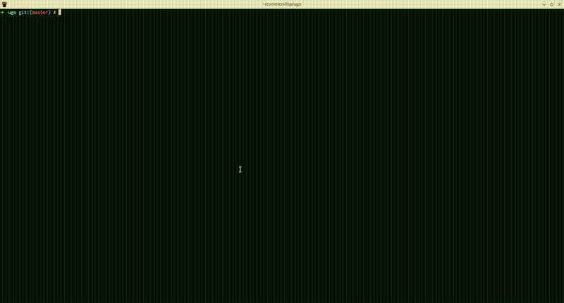

# screencast



The project is currently in alpha stage, only support free-mode.

If the gif is not clear enough, please see the webm.

# 数气制 (liberty counting)

A scoring rule where liberties, not territory, decide the game.

- Stones of the same color connected orthogonally form a group. A group's
  liberties are the empty points orthogonally adjacent to it.
- A side's liberties are the union of the liberties of all its groups, so an
  empty point touching several of your groups still counts only once.
- An empty point adjacent to one side's stones only scores 1 qi for that side.
- An empty point adjacent to both sides (dame) scores for neither. Counting it
  for both would add the same amount to both totals, so it can never change the
  winner.
- A group with no liberties is dead. Dead groups of both sides are removed
  simultaneously before counting, so the points they occupied become liberties
  for the surrounding stones.
- The side with more qi wins; equal qi is a draw.

Note that only the "front line" of empty points scores: an empty point inside a
large eye but not adjacent to any stone is not a liberty. Compared with ordinary
Go this rewards dense, contact-oriented play, and passing becomes attractive
once you are ahead (filling the board tends to reduce both sides' qi).

In the REPL, `(score-qi)` returns the two totals, `(qi-winner)` returns
`:white`, `:black` or `:draw`, and `(show-qi-score)` prints the result. Scoring
works on a copy of the board, so `*board*` is left untouched.

# AI

All players are classical search algorithms; there are no neural networks or
learned models anywhere.

- `mcts-best-move` / engine `:mcts` (the default): UCT / Monte Carlo tree
  search, the standard pre-AlphaGo approach to computer Go. Playouts are light
  (random or a local heuristic) and are evaluated with the exact 数气制 score;
  the tree averages them.
- `minimax-best-move` / engine `:minimax`: beam-limited minimax whose leaves are
  scored with the exact rule. Because this variant's score is static and quite
  symmetric, this is competitive with MCTS and needs fewer simulations.
- `greedy-best-move` / engine `:greedy`: one-ply exact score. A baseline, but a
  surprisingly stubborn one in this variant.

The AI functions, their tuning parameters, the scoring functions and
`*board*`, `*white*`, `*black*` are all exported, so `(ugo:ai-move
ugo:*white*)` works from any package. Or work inside the package:

```lisp
(in-package :ugo)
(ai-move *white*)                            ; MCTS, plays on *board*
(ai-move *black* :engine :minimax)           ; minimax plays on *board*
(ai-move *white* :engine :greedy)

(mcts-best-move *board* *white*              ; choose without playing
                :simulations 20000 :time-limit 5)

(ai-self-play :engine :mcts :max-moves 80)   ; two AIs, prints every move
```

Useful parameters: `*ai-engine*` (`:mcts`, `:minimax`, `:greedy`),
`*ai-simulations*` (5000), `*ai-time-limit*` (3 seconds),
`*uct-c*` (1.414), `*rollout-depth*` (50), `*rollout-policy*`
(`:heuristic` or `:random`), and `*passes-to-end*`.

A caveat about the ending: with the default two consecutive passes, a player
who is behind can refuse to pass and keep filling the board. A full board has
no liberties, so every group is removed and the result is 0:0. If you do not
want that forced draw, set `*passes-to-end*` to 1: a player who is ahead can
then stop the game on their own turn. The search and `ai-best-move` follow this
variable, and with a single-pass ending the AI passes automatically when it is
ahead.

# Practice mode

`practice` starts a new game on an empty board and lets you play against the
AI interactively in the REPL.

```lisp
(practice)                       ; you play 黑 ○ and move first, AI is 白 ●
(practice :human *white*)        ; AI moves first as 黑 ○
(practice :engine :greedy)       ; fast one-ply opponent
(practice :passes-to-end 2)      ; two consecutive passes end the game
```

Enter a move as `column row`, for example `9 9` or `e 5`; labels are 1-9 and
a-j (a=10, j=19), and plain numbers 10-19 are also accepted. Commands are
`pass`/`p`, `help`/`h` and `quit`/`q`. The current qi count is shown after
every move. By default one pass ends the game (the anti-draw ending described
above): the AI passes as soon as it is ahead, and the human may do the same.

# TODO
- a SDL front end
- stronger AI(RAVE, better playout policies, iterative deepening)
- ultimate mode(specify 21x21 or more, any size boards)
- free rules(include self-kill, CJK rules)
- coordinate axis conversion(to support any annotations)
