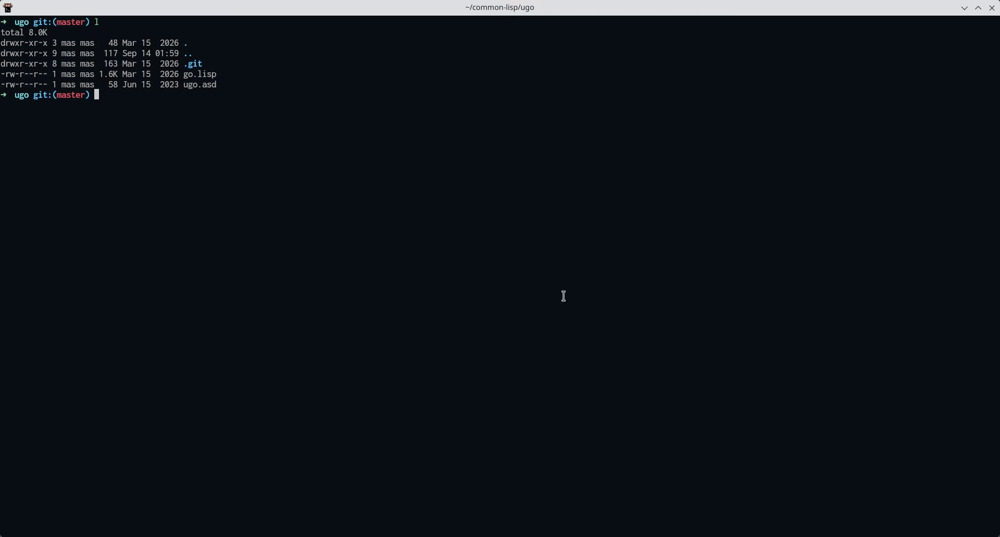

# screencast

The project is currently in alpha stage, only support free-mode.

If the gif is not clear enough, please see the webm.

# TODO
- a SDL front end
- integrate AI
- practice mode
- ultimate mode(specify 21x21 or more, any size boards)
- free rules(include self-kill, CJK rules)
- coordinate axis conversion(to support any annotations)
